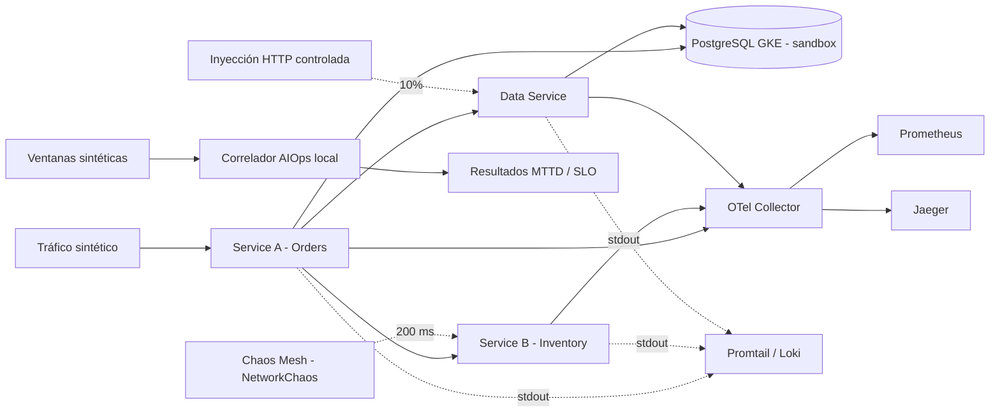

# Observabilidad end-to-end, AIOps y resiliencia multicloud

Laboratorio integrador de la asignatura de Observabilidad. Reúne instrumentación con **OpenTelemetry**, investigación de incidentes, detector estadístico local y experimentos de **Chaos Engineering** en un sandbox **GKE**. El diseño plantea integración con **Cloud SQL** y **AWS RDS**, además de observabilidad de red y seguridad. Este repositorio diferencia explícitamente los recursos desplegados de los que aún son una propuesta.

## Arquitectura observada

**Estado actual:** Service A, Service B y Data Service desplegados y conectados al PostgreSQL de GKE. La ruta `GET /order/ord-001/observed` propaga el contexto de trazas hasta Data Service. Se ejecutaron dos experimentos nuevos con evidencia versionada. **PostgreSQL de GKE no es Cloud SQL.** No se debe describir esta arquitectura como multicloud operativa mientras persista el bloqueo organizacional de AWS.

## Experimentos con evidencia

| Experimento | Perturbación | Solicitudes | HTTP 5xx | P99 máxima | MTTD del detector local |
|---|---|---:|---:|---:|---:|
| E1 | Latencia 200 ms en Service B | 150 | 0 | 566,13 ms | 10,52 s |
| E2 | HTTP 503 con probabilidad 10 % en Data Service | 200 | 24 (12 %) | 254,30 ms | 4,68 s |

Fuente: [`evidence/module-d/20261018T044601Z/`](evidence/module-d/20261018T044601Z/). El detector es **experimental y local**, no un servicio gestionado de AIOps. E1 **no** activa la correlación conjuntiva de errores y P99 porque no produjo errores HTTP. El presupuesto de error informado en la prueba es **ilustrativo**, calculado a partir de una ventana sintética corta.

## Observabilidad de red y seguridad

La fase GCP consulta la telemetría de Jaeger, Prometheus y Loki, configura VPC Flow Logs en el sandbox *si cuenta con permisos* y consulta Security Command Center. Los resultados se documentan sin exponer direcciones IP o secretos. Véase [estado de red y seguridad](docs/OBSERVABILIDAD-RED-SEGURIDAD.md) y los resultados publicados en `evidence/module-c/`.

El dashboard [`grafana-security-signals.json`](observability/grafana-security-signals.json) es una plantilla **pendiente de importación y validación**. La detección de intentos de autenticación fallidos y CVEs requiere fuentes de datos auténticas; un panel `No data` no constituye evidencia de ausencia de incidentes.

## Estructura

- `services/`: microservicios instrumentados con OTel.
- `kubernetes/`: configuración de workloads y telemetría.
- `observability/`: Collector, Grafana y Loki.
- `aiops/`: detector estadístico y pruebas unitarias.
- `chaos/`: definiciones de experimentos con alcance limitado.
- `scripts/`: automatizaciones del laboratorio, incluidas recolección y validación.
- `terraform/`: área de IaC para los recursos cloud aún pendientes.
- `security/`: área de observabilidad de seguridad.
- `evidence/`: resultados y capturas, separados por módulo.
- `docs/`: arquitectura y resultados técnicos.

## Riesgos y brechas

- AWS RDS/VPC: denegación explícita por SCP; no intentar eludir la política.
- Cloud SQL, service mesh L7, AWS Flow Logs y alertas AIOps gestionadas: **pendientes**.
- No afirmar reducción de alertas ruidosas: el comparador estático y el correlado dispararon ocho ventanas en E2.
- Los ensayos usan tráfico sintético corto, no carga representativa de producción.
- Los recursos cloud con facturación activa requieren inventario y un cierre controlado al final del laboratorio.

**Uso académico en sandbox; no desplegar los fallos experimentales en entornos compartidos o de producción.**
