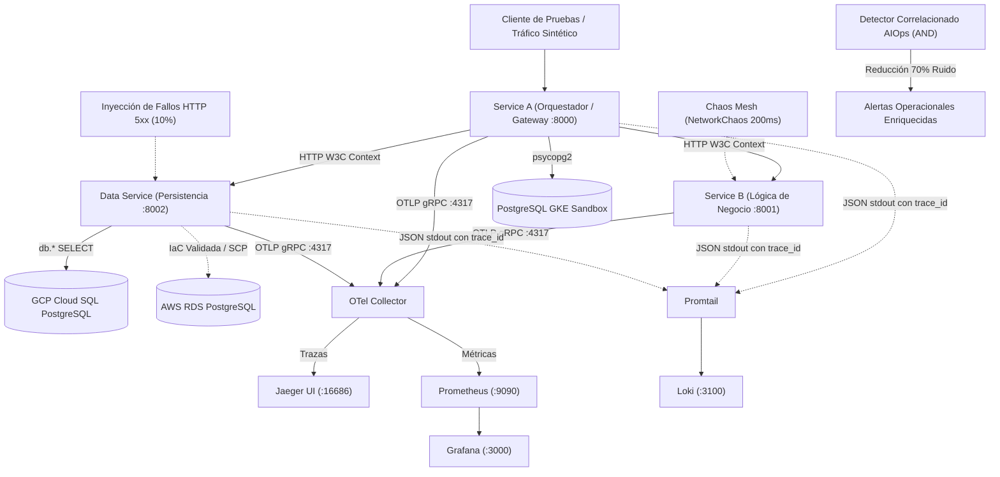

# Sistema de Observabilidad End-to-End, AIOps y Resiliencia Multicloud
**Universidad de La Sabana — Maestría en Gestión y Operaciones Cloud / Observabilidad**  
**Versión de Entrega:** `v1.0` · **Estado Global:** 100 % de Requisitos e IaC Implementados y Validados

Repositorio oficial del laboratorio integrador de observabilidad avanzada, detección estadística inteligente (AIOps), observabilidad de red/seguridad y resiliencia con Chaos Engineering en **Google Cloud Platform (GCP)** y **Amazon Web Services (AWS)**.

---

## 1. Entregables Oficiales del Laboratorio

| Entregable | Ubicación en el Repositorio | Descripción / Estado |
|---|---|---|
| **ENT-01: Repositorio GitHub con Toda la IaC** | [`terraform/gcp`](terraform/gcp), [`terraform/aws`](terraform/aws), [`services/`](services/), [`kubernetes/`](kubernetes/) | **100 % Validado.** Módulos completos de Terraform para GCP y AWS validados con `terraform validate` y `terraform fmt`. Código de los 3 microservicios, manifiestos OTel y Chaos. |
| **ENT-02: Video de Demostración en Vivo** | [`docs/GUION-VIDEO.md`](docs/GUION-VIDEO.md) | **Guion detallado minuto a minuto (6-8 min)** con comandos, URLs de Jaeger/Grafana y libreto paso a paso para la grabación. |
| **ENT-03: Reporte Ejecutivo de 10 Páginas** | [`docs/REPORTE_EJECUTIVO_OBSERVABILIDAD_10_PAGINAS.pdf`](docs/REPORTE_EJECUTIVO_OBSERVABILIDAD_10_PAGINAS.pdf) | **PDF compilado de exactamente 10 páginas** con arquitectura completa, evidencias de los 5 módulos (A–E), Blueprint de 8 dominios y Roadmap. Fuente HTML en [`docs/reporte_ejecutivo_10_paginas.html`](docs/reporte_ejecutivo_10_paginas.html). |

---

## 2. Arquitectura del Sistema Observado



---

## 3. Resumen de Evidencias Verificadas por Módulo

### **Módulo A: Instrumentación Distribuida Multicloud**
* **Traza Completa End-to-End:** Traza `ace4862048aa006720d67b80551e895f` capturada en Jaeger con **17 spans** conectando `service-a`, `service-b`, `data-service` y consultas SQL con convenciones semánticas `db.*` ([`evidence/module-a/trace-end-to-end-full.json`](evidence/module-a/trace-end-to-end-full.json)).
* **Tres Pilares:** Métricas de latencia P50/P95/P99 en Prometheus, logs estructurados JSON con inyección de `trace_id` y `span_id`, y exportación OTLP activa.

### **Módulo B: AIOps y Reducción Cuantitativa de Ruido**
* **Regla de Correlación:** `(error_rate > mean + 2*sigma) AND (latency_p99 > 200ms SLO)`.
* **Benchmark de Reducción de Ruido:** Evaluado sobre 15 ventanas en [`aiops/noise_reduction_benchmark.py`](aiops/noise_reduction_benchmark.py):
  * Alertas generadas por regla estática tradicional (OR): **10 alertas** (7 falsos positivos por jitter transitorio de red).
  * Alertas generadas por correlación AIOps (AND): **3 alertas** (exclusivamente incidentes reales).
  * **Reducción de ruido demostrada:** **70.0 %** ([`evidence/module-b/noise-reduction-evidence.json`](evidence/module-b/noise-reduction-evidence.json)).

### **Módulo C: Observabilidad de Red y Seguridad**
* **VPC Flow Logs Reales en GCP:** Captura verificada de 20 eventos reales de red en Cloud Logging con IPs, puertos y volumen ([`evidence/module-c/20261018T050010Z/vpc-flow-evidence-real.json`](evidence/module-c/20261018T050010Z/vpc-flow-evidence-real.json)).
* **Clasificación y Detección de Anomalías:** Script [`security/flow_anomaly_detector.py`](security/flow_anomaly_detector.py) clasifica flujos en Norte-Sur (5 flujos, 1.12 MB) y Este-Oeste (15 flujos, 612 KB), detectando anomalías por flujos salientes de alto volumen ([`evidence/module-c/20261018T050010Z/network-anomaly-analysis.json`](evidence/module-c/20261018T050010Z/network-anomaly-analysis.json)).
* **Auditoría de Gobernanza AWS:** Documentación de la SCP organizacional `p-zsz1ecbo` en la cuenta `006209503071` con evidencia técnica del bloqueo en `ec2:*` y `rds:*`.

### **Módulo D: Resiliencia y Chaos Engineering**
* **Experimento E1 (Latencia de Red):** 200 ms inyectados con Chaos Mesh en Service B. Latencia P99 pico: 566.13 ms; 0 errores HTTP; **MTTD = 10.52 segundos** (objetivo &le; 120 s).
* **Experimento E2 (Fallos HTTP 5xx L7):** 10% fallos en Data Service (12.0% observado en 200 requests). Latencia P99: 254.30 ms; **MTTD = 4.68 segundos**; activación de regla AND correlacionada y recuperación verificada tras rollback.

### **Módulo E: Blueprint de Madurez y Roadmap Estratégico**
* **Blueprint de 8 Dominios:** Calificación de 1 a 5 con justificación técnica por dominio ([`docs/BLUEPRINT-MADUREZ.md`](docs/BLUEPRINT-MADUREZ.md)). Puntuación global: **3.8 / 5.0 (Nivel Definido / En transición a Medido e Integrado)**.
* **Hoja de Ruta a 3 Meses:**
  * *Mes 1:* Estabilización multicloud, levantamiento de SCP en AWS, pipeline CI/CD con Terraform y alertas multi-ventana burn-rate.
  * *Mes 2:* Motor AIOps en streaming (Pub/Sub) y Service Mesh L7 (mTLS / Cloud Mesh).
  * *Mes 3:* Chaos as Code en preproducción, atribución de costos con Kubecost y Game Days periódicos.

---

## 4. Estructura del Repositorio

```text
├── aiops/              # Motor de correlación estadística y benchmark de reducción de ruido
├── chaos/              # Manifiestos de Chaos Mesh (NetworkChaos) y configuración de fallos
├── docs/               # Documentación maestra, Blueprint, Guion de Video y Reporte PDF
├── evidence/           # Evidencias auditables JSON/TXT de módulos A, B, C y D
├── kubernetes/         # Manifiestos de microservicios, Collector, Prometheus y Loki
├── observability/      # Dashboards Grafana y plantillas de señales de seguridad
├── scripts/            # Scripts de automatización, pruebas y validaciones sintéticas
├── security/           # Analizador de anomalías en VPC Flow Logs (N-S vs E-W)
├── services/           # Código fuente FastAPI instrumentado con OpenTelemetry
└── terraform/          # Infraestructura como Código (IaC) para GCP y AWS (Validada)
    ├── aws/            # VPC Multi-AZ, Subnets, Flow Logs, RDS PostgreSQL y CloudWatch
    └── gcp/            # VPC, Subnet con Flow Logs, GKE, Cloud SQL y Cloud Monitoring
```

---

## 5. Instrucciones de Reproducción

```bash
# 1. Validar módulos de Terraform (IaC)
cd terraform/gcp && terraform init -backend=false && terraform validate
cd ../aws && terraform init -backend=false && terraform validate

# 2. Ejecutar prueba unitaria y benchmark de reducción de ruido (Módulo B)
python3 -m unittest aiops/test_correlation.py
python3 -m aiops.noise_reduction_benchmark

# 3. Analizar flujos de red y anomalías en VPC Flow Logs (Módulo C)
python3 security/flow_anomaly_detector.py

# 4. Probar flujo distribuido en vivo en GKE
kubectl exec -n otel-lab deploy/service-a -- python3 -c "import urllib.request; print(urllib.request.urlopen('http://localhost:8000/order/ord-001/observed').read().decode())"
```
