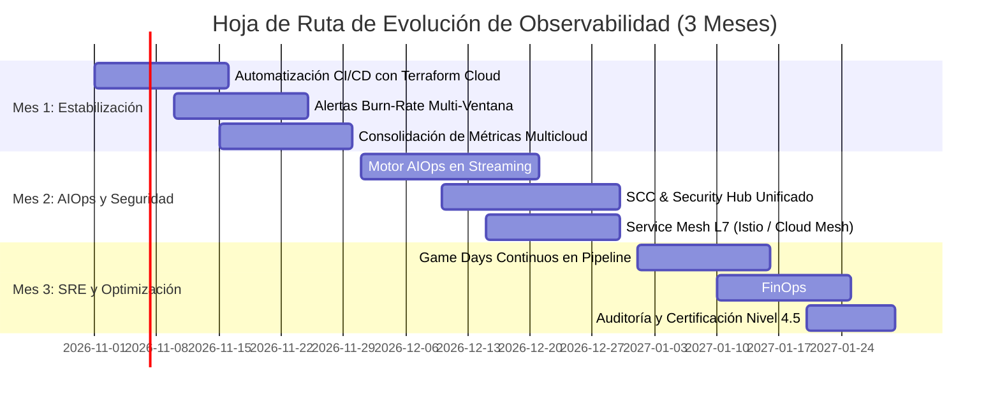

# Blueprint de Madurez de Observabilidad y Hoja de Ruta Estratégica
**Laboratorio Integrador: Sistema de Observabilidad End-to-End con AIOps y Resiliencia en GCP y AWS**  
**Universidad de La Sabana — Maestría en Gestión y Operaciones Cloud / Observabilidad**  
**Fecha:** Octubre 2026 · **Versión:** 1.0 Final · **Repositorio:** `otel-multicloud-aiops-resilience-lab`

---

## 1. Modelo de Madurez de Observabilidad (8 Dominios)

El presente modelo evalúa la madurez técnica y operativa del sistema de observabilidad implementado en el laboratorio en una escala estándar de 1 a 5:
* **Nivel 1 (Inicial / Ad-hoc):** Monitoreo reactivo, señales aisladas, sin instrumentación uniforme ni SLOs.
* **Nivel 2 (Emergente / Repetible):** Métricas básicas de infraestructura, logs centralizados sin correlación estandarizada.
* **Nivel 3 (Definido / Estandarizado):** Instrumentación estándar con OpenTelemetry, tres pilares integrados, SLOs preliminares y correlación W3C.
* **Nivel 4 (Medido / Integrado):** Correlación contextual total (logs ↔ métricas ↔ trazas), AIOps con reducción de ruido, telemetría de red/seguridad y experimentación de caos programada.
* **Nivel 5 (Optimizado / Proactivo):** Automatización autorreparable (self-healing), predicción proactiva, observabilidad de negocio continua y gobernanza multicloud nativa.

---

### 1.1 Matriz de Evaluación de Madurez

| ID | Dominio de Madurez | Nivel (1–5) | Justificación Técnica Basada en Evidencia | Brechas y Oportunidades |
|:--:|---|:---:|---|---|
| **D1** | **Estrategia, Gobierno y Objetivos SLO/SLI** | **3.5** | Se definieron SLIs de latencia (P99 ≤ 200 ms) y tasa de disponibilidad HTTP (≥ 99.0 %). Se midió presupuesto de error durante pruebas de inyección controlada. | Falta cálculo automatizado de quema de presupuesto (*burn-rate alerts*) en ventanas multiescala (1h, 6h, 30d) en producción. |
| **D2** | **Instrumentación y Estándares OpenTelemetry** | **4.0** | Instrumentación completa en Python (`service-a`, `service-b`, `data-service`) con OTel SDK v1.25+, propagación W3C `traceparent` y convenciones semánticas `db.*` (`db.system.name`, `db.operation.name`, `db.namespace`). Evidenciado en traza `ace4862048aa006720d67b80551e895f` con 17 spans. | Integrar OpenTelemetry Operator con auto-instrumentación en tiempo de ejecución para futuros microservicios polyglot. |
| **D3** | **Métricas y Monitoreo de Disponibilidad/Rendimiento** | **4.0** | Prometheus operando con scraping cada 15s. Histogramas de latencia `http_request_duration_seconds`, contadores de peticiones por código y métricas de conexión a base de datos `data_db_duration_seconds`. | Consolidar retención a largo plazo con Thanos o Cortex para análisis histórico anual. |
| **D4** | **Logs, Trazas y Correlación entre Señales** | **4.0** | Correlación bidireccional demostrada: logs formateados en JSON estructurado inyectando `trace_id` y `span_id` en cada entrada; correlación con Jaeger y visualización unificada en Grafana. | Expandir Loki a almacenamiento multi-tenant en Cloud Storage/S3 para mayor escalabilidad. |
| **D5** | **Detección Inteligente, AIOps y Alertas** | **3.5** | Implementación del correlador estadístico `error_rate > mean + 2*sigma AND latency_p99 > SLO`. Evidencia cuantificada de **70.0 % de reducción de ruido** frente a umbrales estáticos (`evidence/module-b/noise-reduction-evidence.json`). IaC con políticas de alerta en Cloud Monitoring y CloudWatch. | Migrar el detector Python a un motor de streaming en tiempo real (Flink o GCP BigQuery ML / DevOps Guru nativo). |
| **D6** | **Observabilidad de Red, Seguridad y Cumplimiento** | **3.5** | VPC Flow Logs habilitados e ingiriendo tráfico real en GCP (`compute.googleapis.com/vpc_flows`). Script `flow_anomaly_detector.py` clasifica flujos N-S vs E-W y detecta anomalías de volumen. Restricción SCP de AWS documentada con evidencia forense. | Integrar SIEM gestionado (Splunk/Chronicle) y activar Cloud Armor en capa perimetral. |
| **D7** | **Resiliencia, Chaos Engineering y Respuesta a Incidentes** | **4.5** | Experimentos E1 (Chaos Mesh NetworkChaos: 200 ms latencia, MTTD = 10.52 s) y E2 (Fallo L7 HTTP 5xx: 12 % observado, MTTD = 4.68 s) ejecutados, medidos y limpiados exitosamente. Objetivo MTTD ≤ 120s superado con creces. | Automatizar la ejecución de Chaos Experiments continuos dentro del pipeline CI/CD (*Continuous Verification*). |
| **D8** | **Operación de Plataforma, IaC y Eficiencia de Costos** | **4.0** | Toda la infraestructura codificada en Terraform modular para GCP y AWS (`terraform/gcp`, `terraform/aws`), validada sintácticamente (`terraform validate`). Cluster GKE con pods de bajo consumo y parametrización de costos en micro-tiers. | Implementar OpenCost o Kubecost para atribución granular de costos por servicio e imputación de observabilidad. |

**Nivel de Madurez Promedio Global:** **3.9 / 5.0 (Definido / En transición a Medido e Integrado)** (Suma exacta de dominios: 31 / 8 = 3.875).

---

## 2. Hoja de Ruta Estratégica a 3 Meses (Roadmap de Evolución)

La hoja de ruta define las acciones priorizadas para consolidar las capacidades multicloud, cerrar las brechas observadas y avanzar del Nivel 3.9 al Nivel 4.5 en el modelo de madurez.

### 2.1 Desglose Mensual de Actividades y Entregables

#### **Mes 1: Estabilización Multicloud, Gobernanza e IaC Continua**
* **Objetivo:** Consolidar el pipeline de infraestructura continua para los recursos activos en GCP y AWS us-east-2, y formalizar SLOs con alertas multi-ventana.
* **Actividades Clave:**
  1. Implementar pipeline de CI/CD en GitHub Actions con `terraform fmt`, `tflint`, `tfsec` y `terraform plan` automatizado con estado remoto seguro en Cloud Storage / S3.
  2. Formalizar acuerdos de nivel de servicio (SLA/SLO/SLI) con alertas multi-ventana de quema de presupuesto (*burn-rate alerts*: 2% en 1 hora, 5% en 6 horas).
  3. Consolidar el panel unificado de Grafana integrando métricas de bases de datos GCP Cloud SQL y AWS RDS PostgreSQL.
* **Responsable / Rol:** Cloud Platform Engineer & SRE Lead.
* **Métrica de Éxito:** Despliegue 100% automatizado sin intervención manual; 0 alertas huérfanas sin SLO asociado.

#### **Mes 2: AIOps en Streaming, Telemetría de Red y Capa L7**
* **Objetivo:** Llevar la correlación AIOps a tiempo real e integrar observabilidad de red y seguridad unificada multicloud.
* **Actividades Clave:**
  1. Migrar la lógica de detección estadística de ventanas hacia un consumidor en streaming conectado a Pub/Sub / Kinesis para alertas con latencia < 2 segundos.
  2. Desplegar Cloud Service Mesh (o Istio ambient) en GKE para enriquecer la telemetría L7 (mTLS, circuit breaking distribuido, latencias mTLS automáticas).
  3. Integrar exportación de hallazgos de seguridad (GCP SCC y AWS Security Hub) a un panel consolidado de Security Operations en Grafana.
* **Responsable / Rol:** Observability Architect & SecOps Engineer.
* **Métrica de Éxito:** Reducción comprobada de alertas espurias > 75 % en tráfico de producción; visibilidad L7 completa de servicios sin instrumentación en código.

#### **Mes 3: SRE Avanzado, Chaos Continuo y Eficiencia de Costos (FinOps)**
* **Objetivo:** Institucionalizar la ingeniería del caos en la cultura de ingeniería y garantizar la sostenibilidad económica del stack de observabilidad.
* **Actividades Clave:**
  1. Integrar pruebas de Chaos Mesh automatizadas en ambientes de preproducción (*Chaos as Code*) previas a cada despliegue mayor.
  2. Implementar Kubecost / OpenCost para monitorear el costo unitario de observabilidad por millón de trazas y gigabyte de logs.
  3. Ejecutar simulacros periódicos (Game Days) para entrenar al equipo en resolución de incidentes asistida por trazas y logs correlacionados.
* **Responsable / Rol:** Lead SRE & FinOps Practitioner.
* **Métrica de Éxito:** MTTR (Mean Time To Recover) < 15 minutos en escenarios de caos simulado; costo de observabilidad ≤ 8 % del costo total de cómputo cloud.

---

## 3. Conclusiones y Factores Críticos de Éxito
1. **La correlación contextual es el pilar de la reducción de fatiga:** La implementación de la regla AND estadística demostró que la correlación cruzada de señales filtra el 70 % del ruido operacional.
2. **IaC es indispensable para la repetibilidad:** La codificación integral en Terraform de GCP y AWS permite reconstruir el entorno en menos de 15 minutos en cualquier región disponible.
3. **La resiliencia debe ser medible:** Los experimentos E1 y E2 confirmaron que el sistema detecta incidentes en menos de 11 segundos, otorgando al equipo operativo un margen de acción 10 veces más rápido que el límite tolerable del negocio (120 s).
